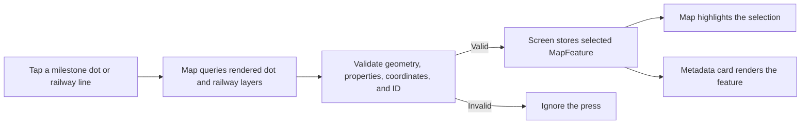

# From a map press to a metadata card

On the native map, tapping a railway line or a milestone selects one railway feature and opens its metadata card. The map adapter identifies the feature; the map screen owns the selection; the card presents it. This guide follows that path so a new developer knows where to make a change.



See the [railway domain glossary](railway-domain.md) for shared models, identity
rules, and the difference between geometry metadata and recorded milestone bounds.

## Follow a milestone tap

Passive markers follow a numerical PK hierarchy, defined in
[`milestone-display.ts`](../src/features/railway-reference/milestone-display.ts). Original marker type
and label padding do not affect eligibility.

| Zoom     | Passive markers                                  |
| -------- | ------------------------------------------------ |
| Below 10 | None                                             |
| 10–<12   | Whole kilometres (position divisible by 1,000 m) |
| 12–<14   | Whole and half kilometres (divisible by 500 m)   |
| 14–<15   | Hectometre positions (divisible by 100 m)        |
| 15+      | Every recorded point                             |

SQLite applies this rule inside the viewport query. Native layer bands apply the
same rule to already-loaded data during zoom transitions. Labels begin at zoom
13 and retain collision avoidance. The selected point remains highlighted from
zoom 10 even when its PK does not match the passive tier; closing the selection
removes this exception. Hiding the marker layer hides the selection too.

Display density does not change search, totals, or navigation. Previous/Next
traverse every recorded point in the same section and focus the destination at
zoom 15. Go to start/end focuses the first/last recorded point at zoom 15 while
keeping the section selected. Endpoints have no passive visibility exception and
never derive from PKD/PKF. A section without whole-kilometre points can show no
passive markers at low zoom. No representative points are synthesized.

1. [`Map`](../src/components/adapters/map/map.tsx) owns the native press handler. The GeoJSON sources render features without source-level selection handlers.
2. [`feature-picker.ts`](../src/components/adapters/map/feature-picker.ts) reads the current native zoom and queries only the active dot layer and mounted selected-circle layer. [`feature-parsing.ts`](../src/components/adapters/map/feature-parsing.ts) validates geometry, railway identity, label, coordinates and matching serialized IDs.
3. Eligible candidates are deduplicated by identity and projected into screen coordinates. The nearest centre inside its circular target wins; exact distance ties use serialized milestone ID order. A valid hit produces `onFeaturePress(milestone)`.
4. [`useMapSelection`](../src/features/use-map-selection.ts) stores `{ feature: milestone, purpose: "browse" }` and exits map-only mode if it was active. The route passes the same selected feature back to the map and to [`MilestoneDetailsCard`](../src/components/composites/map-feature-details-card/milestone-details-card.tsx).
5. The map highlights the selected milestone dot **and** its parent railway section. The card shows the milestone's railway metadata and coordinates.

For example, tapping **PK 509+000** on line **893000**, section **1**, opens a card like this:

```text
POINT KILOMÉTRIQUE
PK 509+000

Code ligne    893000
Section       1
Repère        509+000
Coordonnées   45.74744 N · 4.85933 E
```

The card formats milestone coordinates to five decimal places. Its west-hemisphere label is `W`.

## Marker targets and railway fallback

[`hit-policy.ts`](../src/components/adapters/map/hit-policy.ts) defines shared
circle dimensions and extra tolerance in density-independent screen coordinates.
A normal dot occupies a 5 dp radius including its stroke; the selected circle
occupies 9 dp and receives the same extra tolerance.

| Zoom     |  Extra tolerance | Normal target diameter |
| -------- | ---------------: | ---------------------: |
| Below 10 | No marker target |                      — |
| 10–<12   |             2 dp |                  14 dp |
| 12–<14   |             6 dp |                  22 dp |
| 14–<15   |             3 dp |                  16 dp |
| 15+      |             1 dp |                  12 dp |

Labels remain visible but do not participate in hit testing. A label tap can
select a nearby railway unless it is also inside an eligible dot's target.
Selected irregular points remain eligible from zoom 10, but hidden layers and
points below the display threshold cannot intercept a tap.

If no dot qualifies, the picker queries visible railway layers in a 44×44 dp
window and selects the first valid railway in rendered order. Selected railway
rendering retains priority over passive lines. Empty hits and failed native
queries leave selection unchanged.

[`use-feature-press.ts`](../src/components/adapters/map/use-feature-press.ts)
invalidates pending work after newer taps, camera movement, selection, source or
visibility changes, style reloads and unmount. Obsolete responses are ignored.
Only nearby rendered candidates are projected; the picker does not scan the
viewport dataset or access SQLite.

## Railway lines follow the same path

[`RailwayLinesSource`](../src/components/adapters/map/railway-lines-source.tsx) renders lines; the central picker handles their selection. Its parser accepts only valid `LineString` or `MultiLineString` features with complete railway properties and a matching section ID. It constructs a `Railway` and returns its `RailwaySection` child. The map highlights that section in orange, while the card shows the railway name, line code, section rank, and recorded milestone range. A railway card does not show coordinates.

Milestone dots and labels render above railway lines. Rendering order preserves visual priority; the central picker controls tap priority independently. Tapping another valid feature replaces the single current selection and updates both the highlight and card.

## What changes or clears the card?

| Action                                      | Result                                                                                                  |
| ------------------------------------------- | ------------------------------------------------------------------------------------------------------- |
| Tap another valid milestone or railway line | Replace the selected feature and card contents.                                                         |
| Tap the card's close button                 | Clear selection, highlight, and card.                                                                   |
| Hide the selected feature's layer           | Clear selection and card; hiding the other layer keeps them. Hidden layers do not handle presses.       |
| Enter map-only mode                         | Hide the overlays, including the card. A valid feature press exits map-only mode and displays its card. |

The route renders the card only when a feature is selected and native overlays are visible. The web map is an accessible fallback, not the interactive MapLibre map.

Railway details provide **Premier repère** and **Dernier repère** controls. They focus the lowest or highest recorded PK in the selected section, keeping the railway card and highlight selected. These bounds and the displayed range come from the reference database, independently of geometry metadata. Empty sections disable both controls; a lookup error shows an error toast and either control can retry. Camera focus never starts or changes simulation.

Neighbour and endpoint hooks share [`useSelectionLookup`](../src/features/use-selection-lookup.ts) for loading, retries, duplicate-request prevention, and stale-result protection. Their feature hooks retain neighbour navigation and endpoint camera focus; the shared lifecycle contains no railway-specific actions.

## A map tap is not a simulation request

`useMapSelection` records selection purpose. Tapping a map milestone sets `purpose: "browse"` for inspection. Choosing **Utiliser ce point** in its card or in point search sets `purpose: "simulation-target"`, makes the milestone available to the Start control, and requests camera focus. The card action keeps metadata open; Start remains a separate action.

The card action is disabled during simulation activity and uncertain cleanup or reconciliation. An idle state or a confirmed inactive start error allows preparation, independently of neighbour loading. Closing the card, hiding its layer, or browsing another feature clears the pending target. An active simulation and its Stop control remain unchanged while browsing.

## Viewport loading and camera lifecycle

The owning screen loads railway geometry as a local GeoJSON URI and requests
visible milestones from SQLite after debounced viewport changes. The adapter
converts supplied immutable points through `Milestone.toGeoJSON()`. An empty
source is ready, and the source remains mounted so its dot layer provides a
stable ordering anchor. Railway layers render below that anchor regardless of
source loading order. The map does not load a whole-country point GeoJSON.

[`camera.tsx`](../src/components/adapters/map/camera.tsx) focuses the first
available location at the approved local zoom, then leaves the camera under
user control while later fixes move the marker. A transient reconnect retains
the last valid position; actual location loss removes the marker and restores
the world view. A later acquisition starts a new focus cycle. Explicit recenter
requests focus the latest location at zoom 15, north-up and zero pitch. These
rules apply to real and simulated positions, with reduced-motion transitions.

The native styles follow system appearance, falling back to light when it is
unavailable. They use OpenFreeMap's OpenMapTiles source and glyph service with
attribution. The web implementation is an accessible fallback that does not
initialize MapLibre; native interaction requires a build containing its module.

## Where to change behavior

| Need                                                        | Start here                                                                                                                                                                                                            |
| ----------------------------------------------------------- | --------------------------------------------------------------------------------------------------------------------------------------------------------------------------------------------------------------------- |
| Change native feature selection or hit validation           | [`feature-picker.ts`](../src/components/adapters/map/feature-picker.ts) and [`feature-parsing.ts`](../src/components/adapters/map/feature-parsing.ts)                                                                 |
| Change selection, layer hiding, close, or map-only behavior | [`use-map-selection.ts`](../src/features/use-map-selection.ts)                                                                                                                                                        |
| Change what metadata appears                                | [`RailwayDetailsCard`](../src/components/composites/map-feature-details-card/railway-details-card.tsx) and [`MilestoneDetailsCard`](../src/components/composites/map-feature-details-card/milestone-details-card.tsx) |
| Check the complete interaction on Android                   | [Map-feature selection Maestro flow](../.maestro/tests/manage-map-feature-selection.yaml)                                                                                                                             |

The route that connects these pieces is [`src/app/index.tsx`](../src/app/index.tsx). The map adapter renders and reports presses; it does not own the selected feature or load railway data.
