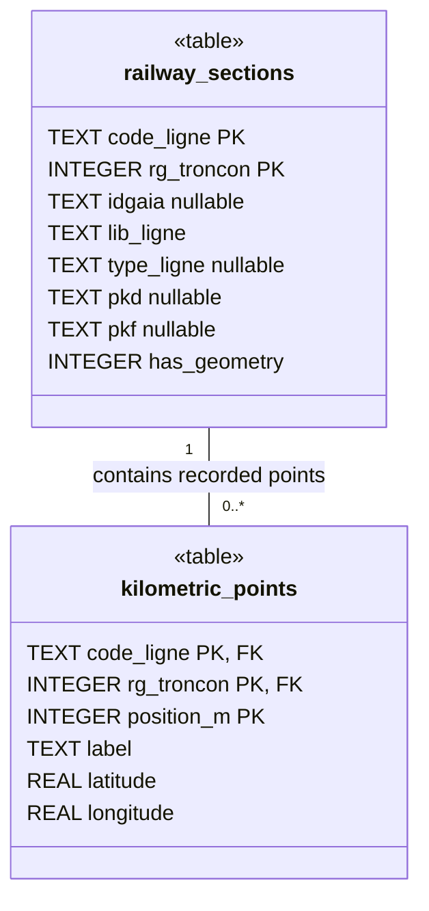

# Railway database asset

UML class view of the tables in the bundled
[`railway_reference.sqlite`](../src/statics/railway_reference.sqlite) asset,
verified against SQLite schema version **2** (`PRAGMA user_version`). The
authoritative schema definitions live in
[`shared/railway-reference/schema.ts`](../shared/railway-reference/schema.ts).

Each recorded kilometric point belongs to exactly one railway section. A section
can have zero or more recorded points.

`PK` marks a member of a composite primary key; `FK` marks a member of the
composite foreign key. All columns are `NOT NULL` unless marked `nullable`.
Both tables use SQLite `STRICT` and `WITHOUT ROWID`.

## Keys and relationship

| Table               | Primary key                            |
| ------------------- | -------------------------------------- |
| `railway_sections`  | `(code_ligne, rg_troncon)`             |
| `kilometric_points` | `(code_ligne, rg_troncon, position_m)` |

The foreign key is
`kilometric_points(code_ligne, rg_troncon) -> railway_sections(code_ligne, rg_troncon)`.
Updates and deletes use `NO ACTION`; there is no cascade.

## Column meaning and constraints

- `code_ligne` is a six-digit railway line code stored as text to preserve leading
  zeroes. `rg_troncon` is a strictly positive section rank within that line.
- `lib_ligne` is the nonempty railway line display name, stored on each section.
  There is no separate railway-line table in this asset.
- `has_geometry` is either `0` or `1`. When it is `1`, `idgaia` (GAIA identifier),
  `type_ligne` (infrastructure type), `pkd` (geometry start PK), and `pkf` (geometry
  end PK) must all be non-null. The database generator writes null metadata for
  fallback sections with `has_geometry = 0`; the SQL check itself only enforces
  the implication for `has_geometry = 1`.
- `position_m` is a non-negative integer railway position in metres. `label` is
  a PK label with digits before `+` and exactly three digits after it; its numeric
  value must match `position_m`. For example, `509+007` represents `509007` metres.
- `latitude` and `longitude` are WGS84 coordinates in degrees, constrained to
  `[-90, 90]` and `[-180, 180]` respectively.

The section's `pkd` and `pkf` describe geometry metadata, not the first and last
recorded points. Recorded milestone ranges are derived from `position_m` for the
exact section; gaps between recorded points are allowed. Geometry vertices are
not stored in these tables. See the [railway domain glossary](railway-domain.md)
for the distinction between geometry limits, recorded ranges, and located bounds.

## Maintenance

Update this diagram when the bundled schema changes. Inspect the asset with
`sqlite3 -readonly src/statics/railway_reference.sqlite '.schema'` and
`sqlite3 -readonly src/statics/railway_reference.sqlite 'PRAGMA user_version;'`,
then compare it with the shared schema definitions. The diagram renders directly
in Markdown viewers that support Mermaid; the surrounding text documents the
relationship and constraints when diagram rendering is unavailable.
