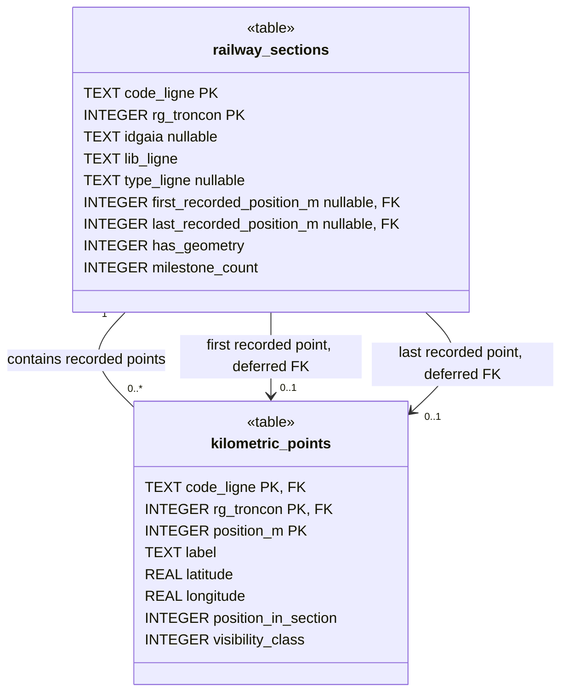

# Railway database asset

UML class view of the tables in the bundled
[`railway_reference.sqlite`](../src/statics/railway_reference.sqlite) asset,
verified against SQLite schema version **5** (`PRAGMA user_version`). The
authoritative schema definitions live in
[`shared/railway-reference/schema.ts`](../shared/railway-reference/schema.ts).

The [Architecture Decision Records](adr/README.md) explain the rationale and
trade-offs behind the asset lifecycle, import policy, precomputed metadata,
geographic index and recorded endpoint relationships.

Each recorded kilometric point belongs to exactly one railway section. A section
can have zero or more recorded points.

> [!WARNING]
> **WARNING: DUPLICATE FILTER APPLIED — FIRST CSV OCCURRENCE WINS.**
> Generation discards later CSV rows with the same line, section rank and
> numerical PK position. It keeps the first row's original label and coordinates,
> without marker-type priority, averaging or geographic accuracy comparison.
> This filter has been applied to the generated assets. Reordering a future
> source CSV can change the coordinates retained for a duplicated position.

## Import policy and audit trail

The importer accepts every `TYPE_REPER`. It retains only PKs with digits before
`+` and exactly three digits after it, representing a non-negative safe integer
metre position. Leading zeroes are preserved. Lettered PKs, minus notation and
four-digit metric parts are skipped with an explicit reason.

Duplicate identity is `(code_ligne, rg_troncon, position_m)`: `001+100` and
`1+100` refer to the same position in the same section. First occurrence means
physical CSV order, before sorting. The importer validates supported identities
before deduplication and validates coordinates on retained rows; later duplicate
coordinates are recorded as raw source text and ignored.

`npm run database:setup` generates SQLite and the railway-line GeoJSON. Before
promotion, SQLite point identities, labels and coordinates are checked directly
against the accepted CSV records. The mobile map queries SQLite for points in the
visible viewport at zoom 10 and above, then converts those points to GeoJSON in
memory for MapLibre. Search and navigation still use every recorded point.
Generation also writes
`src/statics/railway_reference.import-report.json`, containing source SHA-256
hashes, format version, policy, summary, unsupported rows, and each discarded
duplicate with both source rows' line numbers, types, labels and coordinates.
The report and assets are staged, validated and promoted together with rollback
on failure. The report is ignored by Git and included for build validation;
the application does not import it.

Generation prints a **duplicate-filter warning** with counts and the report
path, in red and bold when terminal colors are supported. `NO_COLOR` disables
color; the warning remains explicit in plain output.

For the pinned sources, 372,823 CSV rows become **371,734 points** after skipping
**181 unsupported PKs** and discarding **908 duplicate rows**. Totals and ordinals
are computed only after these filters. The assets contain 1,056 sections,
including 13 without geometry and three geometry-only sections. See the
[numerical-PK audit](railway-endpoint-numeric-audit.md) for source-level examples.

## Database UML



`PK` marks a member of a composite primary key; `FK` marks a member of the
composite foreign key. All columns are `NOT NULL` unless marked `nullable`.
Both tables use SQLite `STRICT` and `WITHOUT ROWID`.

## Keys and relationship

| Table               | Primary key                            |
| ------------------- | -------------------------------------- |
| `railway_sections`  | `(code_ligne, rg_troncon)`             |
| `kilometric_points` | `(code_ligne, rg_troncon, position_m)` |

The foreign key is
`kilometric_points(code_ligne, rg_troncon) -> railway_sections(code_ligne, rg_troncon)`.
Updates and deletes use `NO ACTION`; there is no cascade.

Each section also references its first and last point through composite foreign
keys `(code_ligne, rg_troncon, first_recorded_position_m)` and
`(code_ligne, rg_troncon, last_recorded_position_m)`, targeting the point primary
key. Both are `DEFERRABLE INITIALLY DEFERRED`: generation inserts sections first,
then their points, and checks the complete relationship at transaction commit.
Failure rolls back the transaction. No additional endpoint index is required.

## Column meaning and constraints

- `code_ligne` is a six-digit railway line code stored as text to preserve leading
  zeroes. `rg_troncon` is a strictly positive section rank within that line.
- `lib_ligne` is the nonempty railway line display name, stored on each section.
  There is no separate railway-line table in this asset.
- `has_geometry` is either `0` or `1`. When it is `1`, `idgaia` (GAIA identifier),
  `type_ligne` (infrastructure type) must both be non-null. The database generator writes null metadata for
  fallback sections with `has_geometry = 0`; the SQL check itself only enforces
  the implication for `has_geometry = 1`.
- `position_m` is a non-negative integer railway position in metres. `label` is
  a PK label with digits before `+` and exactly three digits after it; its numeric
  value must match `position_m`. For example, `509+007` represents `509007` metres.
- `latitude` and `longitude` are WGS84 coordinates in degrees, constrained to
  `[-90, 90]` and `[-180, 180]` respectively.
- `milestone_count` is the precomputed number of recorded points in the exact
  section, including zero for geometry-only sections.
- `first_recorded_position_m` and `last_recorded_position_m` reference the lowest
  and highest numerical recorded PK in that exact section. Empty sections require
  both to be null; nonempty sections require non-negative, ordered endpoints.
  One-point sections reference the same point twice. Labels and coordinates remain
  on the points, preserving source label padding without cached duplicates.
- `position_in_section` is the precomputed one-based ordinal of a recorded point,
  ordered by numeric `position_m` within its exact section. Gaps in PK values do
  not create gaps in ordinals. The current-point query joins its parent section
  to retrieve the stored total without runtime counting.

The generator computes these values before insertion. Asset validation independently
recomputes every section count, extrema and numeric-PK ordinal before promotion.
It verifies foreign keys and the schema's deferred declarations. Referencing an
existing interior point passes a foreign key but fails the independent extrema check. No runtime
updates or triggers maintain these values; regenerate the asset when its points change.

## Point visibility classes and geographic index

`visibility_class` defines the minimum passive map visibility tier for a recorded
point. It is a stored, non-null integer between 0 and 3, calculated after CSV
filtering and deduplication from the retained numerical PK. It is independent of
`TYPE_REPER` and label padding. The first matching rule applies:

| Class | Numerical position                        | Passive display zoom |
| ----- | ----------------------------------------- | -------------------- |
| 0     | Divisible by 1,000 metres, including zero | 10 and above         |
| 1     | Otherwise divisible by 500 metres         | 12 and above         |
| 2     | Otherwise divisible by 100 metres         | 14 and above         |
| 3     | All remaining positions                   | 15 and above         |

The stored class expresses map eligibility based on numerical precision; the
application owns the zoom thresholds.
Viewport queries bind the eligible classes using `visibility_class IN (...)` rather than
calculating a modulo for each candidate row. Native map filters continue checking
numerical eligibility to hide stale dense results immediately during zoom-out.
Below zoom 10, or when markers are disabled, all points are hidden. From zoom 10,
a selected point remains highlighted regardless of its passive class. Labels start
at zoom 13 and remain collision-aware.

Search, Previous/Next, counters and section endpoints still use **every recorded
point**, regardless of zoom. Navigation and endpoint focus centre the destination
at zoom 15. Display density never changes recorded bounds.

Generation creates one secondary index after bulk insertion:

```sql
CREATE INDEX kilometric_points_display_idx
ON kilometric_points (visibility_class, longitude, latitude);
```

Because the table uses `WITHOUT ROWID`, SQLite automatically includes its primary
key `(code_ligne, rg_troncon, position_m)` in the index. Labels and ordinals remain
in the primary table and are retrieved for matching points. Generation runs
`ANALYZE` to package planner statistics; the application does not maintain the index
or statistics. Validation independently recomputes every class and checks the full
index layout, including the implicit primary-key suffix.

**Decision: start with the smaller index.** The exploratory desktop SQLite tests
measured approximately **29.48 MiB** for this database versus **33.34 MiB** with a
covering index that also stored `label` and `position_in_section`. On the dense
zoom-10 viewport, median full-result lookup was 2.52 ms with the smaller index,
0.81 ms with covering, and 31.37 ms with the original unindexed query. These are
desktop measurements, not Android performance guarantees. The chosen index
provides a substantial improvement with straightforward SQL and less duplication.

If Android profiling later justifies the extra size, **replace** this index with
`(visibility_class, longitude, latitude, label, position_in_section)` to avoid primary-table
reads. Do not keep both redundant indexes. A covering index is the documented next
step, not part of the current asset.

Schema 5 removes declared geometry `pkd` and `pkf` from SQLite, bundled line
GeoJSON and runtime geometry metadata. Their values are not reliable recorded-point
references; original source files retain them. Search and map details now display
recorded limits from SQLite. This includes sections without geometry.

The catalogue scans sections and joins the first/last points using their existing
composite primary key, avoiding a global point aggregation. Located endpoint
queries look up the section once and retrieve its referenced points directly.
Line GeoJSON carries no recorded endpoint duplicates; map details use their
existing asynchronous SQLite bounds load, including loading, error and empty states.
Recorded limits do not redefine line geometry or guarantee intermediate points
exist. Geometry vertices remain in GeoJSON. See the
[railway domain glossary](railway-domain.md).

Desktop verification with identical complete projections measured catalogue
loading at **65.38 ms before / 5.27 ms after**, approximately **12.4 times faster**.
Individual section bounds were already indexed: their median changed from
15.50 to 13.44 microseconds. The schema-5 asset measures **29.47 MiB**, 8 KiB
smaller after replacing geometry labels with numerical references. Measurements
used Node 24.18.0, SQLite 3.53.1, a 2 MiB connection cache and 30 alternating
rounds, including row materialization; they are desktop results, not Android
latency guarantees. Catalogue loading happens once per provider lifetime.

## Maintenance

The native app imports this asset into `railway_reference_v5_r2.sqlite` on the
device. Its filename combines schema version **5** and data revision **2**,
defined together in the shared version module. This avoids reusing device copies
without the recorded endpoint schema. Subsequent
launches reuse the new copy without overwriting it. Increment the data revision
when changing the bundled dataset without a schema change. The bundled asset
keeps its original filename; no on-device SQL migration or application-data
reset is required.

When revising an unreleased schema without changing its device filename,
regenerate the asset and replace previously imported generated database copies on
development devices while the app is stopped. Preserve other application data;
keep normal asset imports configured to reuse existing copies on later launches.

Fallback sections without geometry reuse the known line name from another
section of the same line. Unknown lines use `Ligne {code}`. Asset validation
rejects conflicting names across searchable sections so the catalogue cannot
be published with an unresolvable line identity. Data revision 2 includes this
correction. Schema version 5 adds recorded endpoint references and removes
declared geometry PK labels, keeping data revision 2 because accepted records
have not changed. Stored classes and the geographic index remain unchanged.

Update this diagram when the bundled schema changes. Inspect the asset with
`sqlite3 -readonly src/statics/railway_reference.sqlite '.schema'` and
`sqlite3 -readonly src/statics/railway_reference.sqlite 'PRAGMA user_version;'`,
then compare it with the shared schema definitions. The diagram renders directly
in Markdown viewers that support Mermaid; the surrounding text documents the
relationship and constraints when diagram rendering is unavailable.
