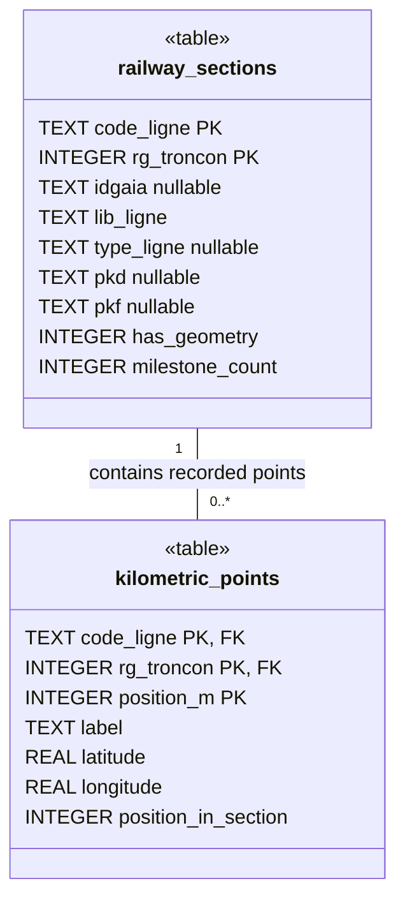

# Railway database asset

UML class view of the tables in the bundled
[`railway_reference.sqlite`](../src/statics/railway_reference.sqlite) asset,
verified against SQLite schema version **3** (`PRAGMA user_version`). The
authoritative schema definitions live in
[`shared/railway-reference/schema.ts`](../shared/railway-reference/schema.ts).

Each recorded kilometric point belongs to exactly one railway section. A section
can have zero or more recorded points.

> [!WARNING]
> **WARNING: DUPLICATE FILTER APPLIED — FIRST CSV OCCURRENCE WINS.**
> Generation discards later CSV rows with the same line, section rank and
> numerical PK position. It keeps the first row's original label and coordinates,
> without marker-type priority, averaging or geographic accuracy comparison.
> This filter has been applied to the generated assets. Reordering a future
> source CSV can change the coordinates retained for a duplicated position.

## Import policy and audit trail

The importer accepts every `TYPE_REPER`. It retains only PKs with digits before
`+` and exactly three digits after it, representing a non-negative safe integer
metre position. Leading zeroes are preserved. Lettered PKs, minus notation and
four-digit metric parts are skipped with an explicit reason.

Duplicate identity is `(code_ligne, rg_troncon, position_m)`: `001+100` and
`1+100` refer to the same position in the same section. First occurrence means
physical CSV order, before sorting. The importer validates supported identities
before deduplication and validates coordinates on retained rows; later duplicate
coordinates are recorded as raw source text and ignored.

`npm run database:setup` generates SQLite and the railway-line GeoJSON. Before
promotion, SQLite point identities, labels and coordinates are checked directly
against the accepted CSV records. The mobile map queries SQLite for points in the
visible viewport at zoom 10 and above, then converts those points to GeoJSON in
memory for MapLibre. Search and navigation still use every recorded point.
Generation also writes
`src/statics/railway_reference.import-report.json`, containing source SHA-256
hashes, format version, policy, summary, unsupported rows, and each discarded
duplicate with both source rows' line numbers, types, labels and coordinates.
The report and assets are staged, validated and promoted together with rollback
on failure. The report is ignored by Git and included for build validation;
the application does not import it.

Generation prints a **duplicate-filter warning** with counts and the report
path, in red and bold when terminal colors are supported. `NO_COLOR` disables
color; the warning remains explicit in plain output.

For the pinned sources, 372,823 CSV rows become **371,734 points** after skipping
**181 unsupported PKs** and discarding **908 duplicate rows**. Totals and ordinals
are computed only after these filters. The assets contain 1,056 sections,
including 13 without geometry and three geometry-only sections. See the
[numerical-PK audit](railway-endpoint-numeric-audit.md) for source-level examples.

## Database UML

`PK` marks a member of a composite primary key; `FK` marks a member of the
composite foreign key. All columns are `NOT NULL` unless marked `nullable`.
Both tables use SQLite `STRICT` and `WITHOUT ROWID`.

## Keys and relationship

| Table               | Primary key                            |
| ------------------- | -------------------------------------- |
| `railway_sections`  | `(code_ligne, rg_troncon)`             |
| `kilometric_points` | `(code_ligne, rg_troncon, position_m)` |

The foreign key is
`kilometric_points(code_ligne, rg_troncon) -> railway_sections(code_ligne, rg_troncon)`.
Updates and deletes use `NO ACTION`; there is no cascade.

## Column meaning and constraints

- `code_ligne` is a six-digit railway line code stored as text to preserve leading
  zeroes. `rg_troncon` is a strictly positive section rank within that line.
- `lib_ligne` is the nonempty railway line display name, stored on each section.
  There is no separate railway-line table in this asset.
- `has_geometry` is either `0` or `1`. When it is `1`, `idgaia` (GAIA identifier),
  `type_ligne` (infrastructure type), `pkd` (geometry start PK), and `pkf` (geometry
  end PK) must all be non-null. The database generator writes null metadata for
  fallback sections with `has_geometry = 0`; the SQL check itself only enforces
  the implication for `has_geometry = 1`.
- `position_m` is a non-negative integer railway position in metres. `label` is
  a PK label with digits before `+` and exactly three digits after it; its numeric
  value must match `position_m`. For example, `509+007` represents `509007` metres.
- `latitude` and `longitude` are WGS84 coordinates in degrees, constrained to
  `[-90, 90]` and `[-180, 180]` respectively.
- `milestone_count` is the precomputed number of recorded points in the exact
  section, including zero for geometry-only sections.
- `position_in_section` is the precomputed one-based ordinal of a recorded point,
  ordered by numeric `position_m` within its exact section. Gaps in PK values do
  not create gaps in ordinals. The current-point query joins its parent section
  to retrieve the stored total without runtime counting.

The generator computes both values before insertion. Asset validation independently
recomputes every section count and numeric-PK ordinal before promotion. No runtime
updates or triggers maintain these values; regenerate the asset when its points change.

The section's `pkd` and `pkf` describe geometry metadata, not the first and last
recorded points. Recorded milestone ranges are derived from `position_m` for the
exact section; gaps between recorded points are allowed. Geometry vertices are
not stored in these tables. See the [railway domain glossary](railway-domain.md)
for the distinction between geometry limits, recorded ranges, and located bounds.

## Maintenance

The native app imports this asset into `railway_reference_v3_r2.sqlite` on the
device. Its filename combines schema version **3** and data revision **2**,
defined together in the shared version module. This avoids reusing earlier
kilometre-only device copies even though the schema is unchanged. Subsequent
launches reuse the new copy without overwriting it. Increment the data revision
when changing the bundled dataset without a schema change. The bundled asset
keeps its original filename; no on-device SQL migration or application-data
reset is required.

Fallback sections without geometry reuse the known line name from another
section of the same line. Unknown lines use `Ligne {code}`. Asset validation
rejects conflicting names across searchable sections so the catalogue cannot
be published with an unresolvable line identity. Data revision 2 includes this
correction; schema version remains 3.

Update this diagram when the bundled schema changes. Inspect the asset with
`sqlite3 -readonly src/statics/railway_reference.sqlite '.schema'` and
`sqlite3 -readonly src/statics/railway_reference.sqlite 'PRAGMA user_version;'`,
then compare it with the shared schema definitions. The diagram renders directly
in Markdown viewers that support Mermaid; the surrounding text documents the
relationship and constraints when diagram rendering is unavailable.
